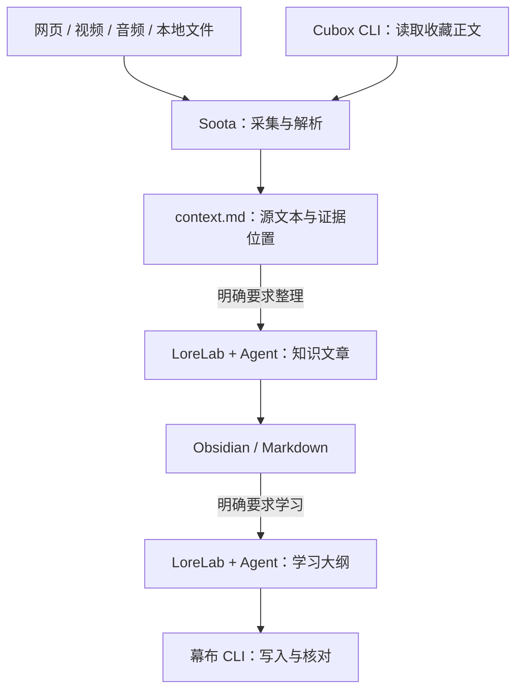

# LoreLab

**采集内容，整理知识，按需学习。**

LoreLab 把 Soota、Cubox CLI、幕布 CLI 和配套 Agent Skills 放进同一个安装包。收集网页、视频、音频、本地文件或 Cubox 收藏，按需要整理成 Obsidian / Markdown 文章，再从选定文章制作幕布学习大纲。每一步都可以单独使用，不必走完整条流程。

[安装](#安装) · [开始使用](#开始使用) · [组件维护](#组件维护) · [文档](#文档)

## 项目与仓库

三个组件均使用 **0xTotoroX 自行开发或二次开发的版本**，与本产品绑定的 Skill 一起交付。

| 项目与仓库 | 职责 | CLI | 配套 Skill |
| --- | --- | --- | --- |
| LoreLab（本仓库） | 知识文章、学习大纲、交付与清理编排，以及成套安装和版本维护 | `lorelab` | [lorelab](skills/lorelab/SKILL.md) |
| [Soota](https://github.com/0xTotoroX/soota) | 正文与媒体采集、下载、解析、context 及采集任务恢复 | `soota` | [soota](modules/soota/skills/soota/SKILL.md) |
| [Cubox CLI](https://github.com/0xTotoroX/cubox-cli) | 查询收藏、批量读取正文、管理文件夹及执行授权清理 | `cubox-cli` | [cubox](modules/cubox-cli/skills/cubox/SKILL.md) |
| [幕布 CLI](https://github.com/0xTotoroX/mubu-cli) | 文档与节点管理、大纲批量写入、导出和回读 | `mubu-cli` | [mubu-integration](modules/mubu-cli/SKILL.md) |

**四个 CLI、四套 Skill，随同一个产品版本安装。** LoreLab Skill 负责文章、学习、交付流程与产品维护，Soota Skill 负责采集和内容包，Cubox 和幕布 Skill 分别负责各自服务的操作。每套 Skill 保留完整引用文件，各 CLI 也可独立使用。

本仓库的 `modules/` 是成套产品的开发主源；上表链接是各组件的自有仓库入口。安装时使用 [components.lock.json](components.lock.json) 绑定的源码与版本，不追随原作者的最新版，也不假定外部组件仓库已包含本仓库的全部修改。组件导出与仓库同步是两个步骤，详见[组件维护](docs/components.md)。

## 内容如何流转



- **采集**：默认到 `context.md` 结束，按原顺序提取源文本，不自动总结、润色或改写。字幕时间轴另存为 `transcript.md`。
- **整理**：明确要求写文章时，由 Agent 阅读来源、目标目录规则和相关既有笔记，将一个或多个来源组织成连贯的文章。分析、总结请求可以直接使用 context，不必先写文章。
- **学习**：从用户选定的已有文章整理学习树，按概念、关系和问题组织，不固定分支数量，也不把一句话拆成多个碎片。

Soota 负责生成 context 和采集任务恢复；LoreLab 负责跨来源的文章整理、学习大纲、交付核对与授权清理。工作流与写作提示词只在 LoreLab 维护，LoreLab 通过 Soota 获取和校验内容包，不实现另一套采集或 context 解析器。语义理解和写作由 Agent 完成，CLI 不自行调用语言模型。

现有内容包转入知识任务时，目前会再建立本地分析包；原包保持只读，不重新下载媒体。LoreLab 编排这一过程，解析仍调用 Soota，详见[内容包输入](docs/knowledge.md#现有内容包输入)。

## 安装

当前构建目标为 **macOS Apple Silicon（arm64）**。在完整安装包的解压目录中执行：

```sh
sh install.sh --prefix "$HOME/.local/share/lorelab" \
  --skills-dir "$HOME/.agents/skills"
export PATH="$HOME/.local/share/lorelab/bin:$PATH"
lorelab doctor
lorelab skills list
```

`--skills-dir` 指定 Agent 的 Skill 注册目录，可以按使用的 Agent 调整。遇到已有的非 LoreLab 同名 Skill，安装会停止并保留原内容；可以改用空目录，或省略此参数，仅安装工具与随包 Skills。

安装包包含 Cubox 二进制、Python 依赖 wheel、组件源码与完整 Skills。首次安装仍可能联网获取 uv 和 Python；账号登录、浏览器桥接及可选媒体工具按任务配置。安装器不修改 shell 配置，以上 `export` 只影响当前终端。从源码目录安装还需要 Go 和构建工具，详见[安装、更新与恢复](docs/installation.md)。

## 开始使用

### 获取可供阅读和分析的原文

```sh
soota ingest "https://example.org/article" --want context --max-cost 0 --json
soota ingest /path/to/audio.m4a --want transcript,context --json
```

只需要下载、提取字幕或分析原文时，使用 [Soota 的对应命令](modules/soota/README.md) 即可。采集不会自动写入知识库或幕布。

### 将来源整理为知识文章

先指定知识库，再选择 Cubox 收藏 ID 或已有的 Soota v2 内容包：

```sh
lorelab knowledge init --vault /path/to/KnowledgeVault --subdir 知识

# Cubox 收藏：文件中每行一个 ID
lorelab knowledge prepare --ids-file /path/to/card-ids.txt

# 或使用已有内容包：JSON 文件中列出包路径字符串数组
lorelab knowledge prepare --bundles-file /path/to/source-bundles.json
```

两种来源参数互斥。Cubox 正文缺失时，可先通过 Soota 补抓，再用 `--source-bundles` 传入收藏 ID 到补抓包的映射。

让 Agent 按 **LoreLab Skill** 阅读来源并填写 `prepare` 返回的审阅模板，再提交和核对：

```sh
lorelab knowledge submit /path/to/job --file /path/to/review.json
lorelab knowledge publish /path/to/job
lorelab knowledge verify /path/to/job
```

文章以足够理解和使用为准，不强制长文、固定要点数量或额外保存一份短笔记。默认在文章写入并回读后完成；只有明确选择同批交付大纲时，才在 `prepare` 加 `--with-outline` 并指定幕布目标。审阅字段、补抓、清理及恢复方法见 [LoreLab 知识流程](docs/knowledge.md)。

### 从已有文章制作学习大纲

```sh
lorelab study prepare --article /path/to/KnowledgeVault/知识/主题.md \
  --vault /path/to/KnowledgeVault --mubu-doc DOCUMENT_ID
lorelab study submit /path/to/study-job --file /path/to/study-review.json
lorelab study publish /path/to/study-job
lorelab study verify /path/to/study-job
```

在 `prepare` 和 `submit` 之间，让 Agent 根据返回的模板整理大纲。`study` 只读选定文章，不重抓来源、不重写文章或清理收藏；原收藏已删除也可以使用。文章完成不会自动触发幕布同步，也不建立幕布返回 Obsidian 的索引。

## 数据与交付边界

- **保留人工修改**：已有同路径文章内容不同时停止，当前不自动合并或覆盖。
- **完整性需要实读**：非空正文、下载成功或 hash 校验通过，都不等于原帖和媒体内容已完整处理。
- **收藏默认保留**：适用的明确授权下，Cubox 批次才可启用 `--delete-verified`。核对完成后，先用 `lorelab knowledge cleanup JOB` 预览，再加 `--execute` 执行；资料不全和 GitHub 项目保留。内容包批次始终不删除原包或媒体。
- **旧任务保留原门槛**：`soota knowledge/study` 仅作兼容转发，需要已安装 LoreLab；新任务使用 `lorelab knowledge/study`。已有任务与配置可按原路径继续使用，升级不扩大删除授权。旧 `lorehub` 命令已移除，迁移方法见[升级说明](docs/installation.md#从-lorehub-升级)。

公开源码与安装包不包含账号凭据、收藏正文、私人知识库路径或执行台账。`doctor` 检查安装与组件绑定，不代表真实账号或云端交付已验收。

## 组件维护

安装 LoreLab 后，可以直接使用三个独立 CLI；通过产品入口调用时，会选择当前产品绑定的版本：

```sh
lorelab tool cubox -- card batch --ids-file /path/to/card-ids.txt
lorelab knowledge status /path/to/job
lorelab tool mubu -- --agent --help
lorelab components verify
lorelab components export soota /path/to/new-soota-checkout
```

开发时修改 `modules/` 内对应组件及 Skill，完成检查后刷新组件锁、重建并安装。独立导出包含源码、构建文件、完整 Skill 和许可证；导出的 Soota 可独立采集、下载、解析与恢复任务，不依赖 LoreLab Python 包；知识整理和学习交付在 LoreLab 中运行。导出不会自动提交或同步到上表的外部仓库。

在本仓库验证与构建：

```sh
uv run --python 3.12 pytest
uv run python -m lorelab.cli components verify
python3 packaging/build_release.py --output-dir dist
```

## 文档

| 主题 | 入口 |
| --- | --- |
| 安装、更新、恢复与源码构建 | [安装说明](docs/installation.md) |
| 版本绑定、组件维护与独立导出 | [组件维护](docs/components.md) |
| 采集目标、任务状态与恢复 | [Soota 任务文档](modules/soota/docs/tasks.md) |
| 知识文章、学习任务与交付核对 | [LoreLab 知识流程](docs/knowledge.md) |
| Agent 的审阅与写作提示词 | [LoreLab 提示词](skills/lorelab/references/prompts.md) |

## 许可证

LoreLab 与 Soota 使用 GPL-3.0-only；Cubox CLI 与幕布 CLI 保留各自的 MIT 许可证及原作者声明，详见 [NOTICE.md](NOTICE.md)。
