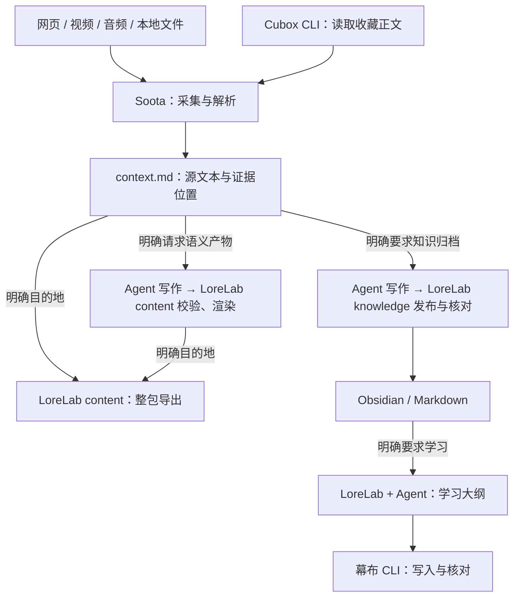

# LoreLab

**采集内容，整理知识，按需学习。**

LoreLab 在一个仓库中维护 Soota、Cubox CLI、幕布 CLI 和四套独立 Agent Skills，由本地 Agent 安装和更新。收集网页、视频、音频、本地文件或 Cubox 收藏，按需要分析、写笔记或整理成 Obsidian / Markdown 文章，再从选定文章制作幕布学习大纲。每一步都可以单独使用，不必走完整条流程。

[安装](#安装) · [开始使用](#开始使用) · [组件维护](#组件维护) · [文档](#文档)

## 项目与仓库

三个组件均使用 **0xTotoroX 自行开发或二次开发的版本**，与本产品绑定的 Skill 一起交付。

| 项目与仓库 | 职责 | CLI | 配套 Skill |
| --- | --- | --- | --- |
| LoreLab（本仓库） | 单来源语义内容与导出、知识文章、学习交付与清理，以及成套安装维护 | `lorelab` | [lorelab](skills/lorelab/SKILL.md) |
| [Soota](https://github.com/0xTotoroX/soota) | 正文与媒体采集、下载、解析、context 及采集任务恢复 | `soota` | [soota](modules/soota/skills/soota/SKILL.md) |
| [Cubox CLI](https://github.com/0xTotoroX/cubox-cli) | 查询收藏、批量读取正文、管理文件夹及执行授权清理 | `cubox-cli` | [cubox](modules/cubox-cli/skills/cubox/SKILL.md) |
| [幕布 CLI](https://github.com/0xTotoroX/mubu-cli) | 文档与节点管理、大纲批量写入、导出和回读 | `mubu-cli` | [mubu-integration](modules/mubu-cli/SKILL.md) |

**四个 CLI、四套 Skill，随同一个产品版本安装。** LoreLab Skill 负责分析、笔记、文章、分类审阅、学习交付与产品维护，Soota Skill 负责采集和内容包，Cubox 和幕布 Skill 分别负责各自服务的操作。每套 Skill 保留完整引用文件，各 CLI 也可独立使用。

本仓库的 `modules/` 是开发主源；上表链接是各组件的自有仓库入口。**Soota 源码与 Skill 只改一处**：检查通过后可自动同步到独立 Soota 仓库，保留原历史和独立安装能力。安装使用 [components.lock.json](components.lock.json) 绑定版本。同步需要配置工作流与认证，见[同步与统一发布](docs/releases.md)；Cubox、幕布继续支持独立导出。

## 内容如何流转



- **采集**：默认到 `context.md` 结束，按原顺序提取源文本，不自动总结、润色或改写。字幕时间轴另存为 `transcript.md`。
- **分析与笔记**：需要保存单来源分析、笔记、文章或大纲时使用 `lorelab content`，Agent 读取 context 写作，CLI 校验并保存。普通聊天总结直接回答，不要求入库。
- **整理**：明确要求写文章时，由 Agent 阅读来源、目标目录规则和相关既有笔记，将一个或多个来源组织成连贯的文章。分析、总结请求可以直接使用 context，不必先写文章。
- **学习**：从用户选定的已有文章整理学习树，按概念、关系和问题组织，不固定分支数量，也不把一句话拆成多个碎片。

Soota 负责生成 context 和采集任务恢复；LoreLab content 负责所有单来源语义产物的校验、渲染和整包导出，knowledge/study 负责知识文章、学习大纲、交付核对与授权清理。工作流与写作提示词只在 LoreLab 维护，LoreLab 通过 Soota 获取并校验原文内容包，不实现另一套采集或 context 解析器。语义理解和写作由 Agent 完成，CLI 不自行调用语言模型。

现有内容包转入知识任务时，目前会再建立本地分析包；原包保持只读，不重新下载媒体。LoreLab 编排这一过程，解析仍调用 Soota，详见[内容包输入](docs/knowledge.md#现有内容包输入)。

## 安装

把本仓库地址交给能执行本机命令的 Agent：

> 请按仓库的 docs/agent-install.md 安装 LoreLab，检查四个 CLI 和四套 Skill。保留我已有的配置和任务。

Agent 克隆仓库、读取安装指引后执行本机入口。用户不需要下载 LoreLab 安装包，也不需要手动安装四个项目。

| 本机环境 | 在仓库目录执行 |
| --- | --- |
| macOS（Apple Silicon / Intel） | `sh install.sh` |
| Linux（arm64 / x64） | `sh install.sh` |
| Windows 原生 PowerShell | `powershell.exe -NoProfile -ExecutionPolicy Bypass -File .\install.ps1` |

安装器复用已有 uv / Go，缺少时从固定官方来源获取到用户目录；Python、依赖、Go 模块和构建缓存共用。四个 CLI 从本仓库绑定的源码构建，安装相同内容时校验后复用当前版本。Windows 使用原生 `.exe` 入口和目录 junction，不要求 WSL 或开发者模式。

Windows 尚未完成实机安装验收；外部 yt-dlp 下载与 FFmpeg 转换目前也有[平台限制](modules/soota/docs/providers.md#windows-运行)。macOS arm64 已完成本机源码安装与升级验证。

安装输出会给出完整路径。接着由 Agent 执行 `lorelab setup`、`lorelab doctor`、`lorelab skills list`。默认 prefix 为用户目录下的 `.local/share/lorelab`，CLI 注册到 `.local/bin`，Skill 注册到 `.agents/skills`；可用 `--prefix`、`--bin-dir`、`--skills-dir` 调整。setup 保留已有配置与任务，按需设置知识库及命令路径。账号登录、浏览器桥接和可选媒体工具按实际任务配置。

升级同样交给 Agent：

```sh
lorelab update --check
lorelab update
# 明确采用另一份本地源码时：
lorelab update --from /path/to/lorelab-checkout
```

首次从 Git 仓库安装会记录来源和分支。更新获取独立源码快照并在新 release 验证，成功后切换四个 CLI / Skill；不会对原工作区执行 pull、reset 或覆盖未提交修改。无来源记录时需显式指定 `--from`，或 `--repo` 和 `--ref`。已有配置、任务和旧 release 保留；外部同名命令或 Skill 不覆盖。

平台验证范围、代理和缓存、旧安装迁移见[安装、更新与恢复](docs/installation.md)。

### 四套 Skill 插件

一个 **LoreLab 插件**提供 `lorelab`、`soota`、`cubox`、`mubu-integration` 四套独立 Skill、引用文档和源码安装指引。**插件不含 CLI、依赖或安装包**；需要时由本地 Agent 从用户指定的仓库安装。

插件模式执行安装和 setup 时加 `--no-skills`，避免重复注册；通过 `lorelab doctor --plugin-root DIR` 核对 Skill 和 CLI 的源码版本。插件刷新由宿主管理，CLI 更新由 Agent 执行，详见[插件说明](docs/plugins.md)。

## 开始使用

### 获取可供阅读和分析的原文

```sh
soota ingest "https://example.org/article" --want context --max-cost 0 --json
soota ingest /path/to/audio.m4a --want transcript,context --json
```

只需要下载、提取字幕或保存原文时，使用 [Soota 的对应命令](modules/soota/README.md) 即可。采集不会自动写入知识库或幕布。

### 单来源分析、笔记与导出

```sh
lorelab content ingest "https://example.org/article" --want context,note
# Agent 读取实际 context 和 analysis-request.json，写好提交后：
lorelab content resume JOB --analysis /path/to/submission.json

# 已有内容包也可独立渲染或导出：
lorelab content render --bundle /path/to/bundle --analysis /path/to/submission.json
lorelab content export --bundle /path/to/bundle --destination /path/to/archive
lorelab content export --bundle /path/to/bundle --vault /path/to/KnowledgeVault --subdir 收件箱
```

`note/article/analysis/outline` 由 LoreLab content 处理，采集复用 Soota；Soota 新任务只接受 `video/audio/transcript/context/markdown/images/data`。分析和总结无需先写文章，只有明确请求归档才选知识目的地。导出保护人工修改，渲染 `--force` 不取消导出冲突检查。字段与旧任务恢复见 [内容处理](docs/content.md)。

### 将来源整理为知识文章

先指定知识库，再选择 Cubox 收藏 ID 或已有的 Soota v2 内容包：

```sh
lorelab knowledge init --vault /path/to/KnowledgeVault --subdir 知识

# Cubox 收藏：文件中每行一个 ID
lorelab knowledge prepare --ids-file /path/to/card-ids.txt

# 或使用已有内容包：JSON 文件中列出包路径字符串数组
lorelab knowledge prepare --bundles-file /path/to/source-bundles.json
```

两种来源参数互斥。Cubox 正文缺失时，可先通过 Soota 补抓，再用 `--source-bundles` 传入收藏 ID 到补抓包的映射。

让 Agent 按 **LoreLab Skill** 阅读来源并填写 `prepare` 返回的审阅模板，再提交和核对：

```sh
lorelab knowledge submit /path/to/job --file /path/to/review.json
lorelab knowledge publish /path/to/job
lorelab knowledge verify /path/to/job
```

文章以足够理解和使用为准，不强制长文、固定要点数量或额外保存一份短笔记。默认在文章写入并回读后完成；只有明确选择同批交付大纲时，才在 `prepare` 加 `--with-outline` 并指定幕布目标。审阅字段、补抓、清理及恢复方法见 [LoreLab 知识流程](docs/knowledge.md)。

### 按主题建立知识图书馆

用 `lorelab knowledge library init` 从空分类开始，`tree/catalog` 查看和检索。Agent 根据实际内容与反馈，用 `library evolve` 主动调整短类别、归属和排序；CLI 自动编码、校验影响、更新导航并保留回退，旧文和链接保持原位。已有人工修改受保护，无需另接模型。流程与边界见 [自适应分类](docs/library.md)。

### 从已有文章制作学习大纲

```sh
lorelab study prepare --article /path/to/KnowledgeVault/知识/主题.md \
  --vault /path/to/KnowledgeVault --mubu-doc DOCUMENT_ID
lorelab study submit /path/to/study-job --file /path/to/study-review.json
lorelab study publish /path/to/study-job
lorelab study verify /path/to/study-job
```

在 `prepare` 和 `submit` 之间，让 Agent 根据返回的模板整理大纲。`study` 只读选定文章，不重抓来源、不重写文章或清理收藏；原收藏已删除也可以使用。文章完成不会自动触发幕布同步，也不建立幕布返回 Obsidian 的索引。

## 数据与交付边界

- **保留人工修改**：分类、查重和合并由 Agent 审阅；`knowledge publish` 仅写新路径或复用相同 bytes，已有同路径文章内容不同时停止，不自动合并或覆盖。
- **完整性需要实读**：非空正文、下载成功或 hash 校验通过，都不等于原帖和媒体内容已完整处理。
- **收藏默认保留**：适用的明确授权下，Cubox 批次才可启用 `--delete-verified`。核对完成后，先用 `lorelab knowledge cleanup JOB` 预览，再加 `--execute` 执行；资料不全和 GitHub 项目保留。内容包批次始终不删除原包或媒体。
- **旧任务保留原门槛**：旧 `soota ingest` 的语义目标/导出参数、旧语义或交付任务的 `soota jobs resume` 及 `soota render` 仅通过隐藏桥转 LoreLab content；未安装 LoreLab 时明确报错且不修改任务。`soota knowledge/study` 同样仅作兼容转发。新操作使用 `lorelab content/knowledge/study`。原 task/item 身份、source 证据、路径、预算与产物保留。已有任务与配置可按原路径继续使用，升级不扩大删除授权。旧 `lorehub` 命令已移除，迁移方法见[升级说明](docs/installation.md#从-lorehub-升级)。

公开源码与插件不包含账号凭据、收藏正文、私人知识库路径或执行台账。`doctor` 检查安装与组件绑定，不代表真实账号或云端交付已验收。

## 组件维护

安装 LoreLab 后，可以直接使用三个独立 CLI；通过产品入口调用时，会选择当前产品绑定的版本：

```sh
lorelab tool cubox -- card batch --ids-file /path/to/card-ids.txt
lorelab knowledge status /path/to/job
lorelab tool mubu -- --agent --help
lorelab components verify
lorelab components export soota /path/to/new-soota-checkout
```

开发时修改 `modules/` 内对应组件及 Skill，完成检查后刷新组件锁并提交。三个组件自动同步使用已提交的主源；正式配对发布仍限于 LoreLab 与 Soota：

```sh
lorelab components refresh --source /path/to/lorelab
lorelab components sync cubox --source /path/to/lorelab
lorelab components sync mubu --source /path/to/lorelab
lorelab components sync soota --source /path/to/lorelab
lorelab components sync soota --source /path/to/lorelab --execute
# 发布准备示例，两个版本号可不同：
lorelab release prepare --source /path/to/lorelab --version 0.2.0 --soota-version 0.1.1
```

同步默认预览，加 `--execute` 才推送；已配置的 GitHub 主分支工作流验证后自动同步。正式发布入口统一绑定两包版本、提交与标签，拒绝覆盖已有版本。独立导出仍包含源码、构建文件、完整 Skill 和许可证，`export` 本身不推送。独立 Soota 的采集、下载、解析与恢复不依赖 LoreLab；语义分析、笔记、文章、大纲、整包导出和知识学习交付在 LoreLab 运行。详见[同步、发布与中断恢复](docs/releases.md)。

在本仓库验证与构建：

```sh
uv run --python 3.12 pytest
uv run python -m lorelab.cli components verify
python3 packaging/build_plugin.py --output-dir dist
```

## 文档

| 主题 | 入口 |
| --- | --- |
| Agent 安装指引 | [Agent 安装](docs/agent-install.md) |
| 安装、更新、恢复与源码构建 | [安装说明](docs/installation.md) |
| 四套独立 Skill 的插件与源码安装 | [插件说明](docs/plugins.md) |
| 版本绑定、组件维护与独立导出 | [组件维护](docs/components.md) |
| 组件单主源、自动同步与两包发布 | [同步与发布](docs/releases.md) |
| 采集目标、任务状态与恢复 | [Soota 任务文档](modules/soota/docs/tasks.md) |
| 单来源分析、笔记、文章、渲染与导出 | [LoreLab 内容处理](docs/content.md) |
| 知识文章、学习任务与交付核对 | [LoreLab 知识流程](docs/knowledge.md) |
| Agent 的审阅与写作提示词 | [LoreLab 提示词](skills/lorelab/references/prompts.md) |

## 许可证

LoreLab 与 Soota 使用 GPL-3.0-only；Cubox CLI 与幕布 CLI 保留各自的 MIT 许可证及原作者声明，详见 [NOTICE.md](NOTICE.md)。
