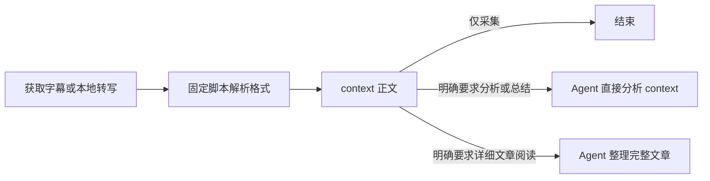

# 字幕格式与 context

核对日期：2026-10-04。表中“工具能力”与“Soota 当前使用”分别列出；实际可取格式还取决于站点、版本和具体字幕轨道。

## 工具与格式

| 工具／来源 | 工具可提供的字幕表示或输出格式 | Soota 当前使用 |
| --- | --- | --- |
| OpenCLI：YouTube、Bilibili | JSON、YAML、CSV、Markdown 表格、终端表格，均为提取后片段的序列化输出 | 逐段 JSON；YouTube 使用 `--mode raw` |
| yt-dlp：YouTube | JSON3、SRV1、SRV2、SRV3、TTML、SRT、VTT | JSON3 |
| yt-dlp：Bilibili 普通视频 | 将 B站字幕 JSON 转为 SRT；另有弹幕 XML | SRT，排除弹幕 |
| TikHub：YouTube | JSON3、XML、SRT、TXT | SRT |
| TikHub：Bilibili | 字幕信息 JSON，以及字幕地址指向的 B站原生 JSON | 字幕 `body` JSON |
| Downie 4 | 默认 SRT；可设置保留站点原格式，官方没有列出固定的原始格式全集 | 未接入字幕采集，只作可选媒体／音频来源 |
| Whisper／MLX Whisper：本地生成 | JSON、SRT、VTT、TXT、TSV；Whisper 当前上游另有 JSONL | JSON 中的识别片段 |
| faster-whisper：本地生成 | Python 片段迭代器及识别信息；导出文件由调用方负责 | `start/end/text` 片段 |

OpenCLI 的 JSON 是它自己的行结构，不是 YouTube JSON3。它的 raw 表示逐段输出，不保证上游原始字节或全部字段原样保留。TikHub 的 API 外壳是 JSON，也不代表字幕正文格式就是 JSON；正文格式由接口参数和返回结构决定。语音识别模型生成文字属于转写，不是下载已有字幕。

来源：[OpenCLI 输出格式](https://github.com/jackwener/opencli#output-formats)、[YouTube 提取器](https://github.com/yt-dlp/yt-dlp/blob/master/yt_dlp/extractor/youtube/_video.py)、[Bilibili 提取器](https://github.com/yt-dlp/yt-dlp/blob/master/yt_dlp/extractor/bilibili.py)、[TikHub YouTube](https://docs.tikhub.io/431829301e0)、[TikHub Bilibili](https://docs.tikhub.io/420748831e0)、[Downie 字幕](https://software.charliemonroe.net/help/downie/?article=subtitles)、[Whisper 输出](https://github.com/openai/whisper/blob/main/whisper/transcribe.py)、[MLX Whisper](https://github.com/ml-explore/mlx-examples/blob/main/whisper/mlx_whisper/cli.py)、[faster-whisper](https://github.com/SYSTRAN/faster-whisper#usage)。

## 格式优先级

比较前提是同一视频、语言和字幕轨道，正文完整，而且当前解析器能正确处理该格式。格式偏好不改变 Provider 的优先级，也不要求重复获取已经成功取得的字幕。

| 优先级 | 格式 | 依据 |
| --- | --- | --- |
| 1 | 原生结构化字幕 JSON／JSON3 | 正文、时间和实际存在的附加字段明确，适合程序提取 |
| 2 | 已知结构的逐段 JSON，如 OpenCLI raw | 易解析，但可能已经删减上游字段 |
| 3 | VTT、TTML、SRV/XML | 可包含时间和说话人等标记，需按对应格式解析 |
| 4 | SRT | 正文和起止时间简单明确，附加信息通常较少 |
| 5 | 纯 TXT | 适合直接读文字，但时间轴和片段结构通常已丢失 |

这是采集格式的选择原则；当前实际使用的格式仍以上表最后一列为准，没有新增全格式自动回退或统一导出功能。`.json` 后缀本身没有优先权，必须是已知字幕结构。若 VTT/XML 比某个被裁剪的 JSON 保留更多相关信息，应优先更完整的结果。文件格式与人工／AI 字幕质量、原语言／翻译轨道是不同的选择维度。

## 默认交付 context

`ingest` 默认保存：

- `context.md`：面向 Agent 的正文。按规范化字幕片段的原顺序输出，保留片段 ID、原文、重复和断句；不合并段落、不修辞、不纠错、不补写，也不插入摘要占位。
- `transcript.md`：保留片段 ID 和毫秒时间轴，供引用核对。精度以来源为限，旧秒格式不能恢复此前已丢失的小数信息。
- `manifest.json`：来源、字幕状态、处理记录和文件索引；未请求分析时标记 `analysis.status=not_requested`。

已有的明确过滤选项在 context 生成之前生效；启用推广过滤时仍保留 `transcript.original.md`。context 忠实于交给 Soota 的规范化片段，不承诺恢复上游已经删掉的字段。

单纯采集到 context 就结束。分析／总结任务可以直接使用 context，不先生成长文章。只有用户明确要求详细阅读文章时，才调用语言模型重组、润色和组织文章。固定脚本不承担这种语义处理，CLI 也不会自动读取提示词并调用语言模型。

新视频内容包的 JSON 返回 `data.context`；`ingest` 的旧 `data.content` 暂作兼容别名，指向同一个 context 文件。`catalog` 的 `data.content` 仍指向目录文件，不受此规则影响。旧包没有 context 时，Agent 读取 `transcript.md`，不把旧文章当作源正文。

## 可选阅读与分析产物

`content.md` 仅作为显式阅读／分析输出。标准分析可由 Agent 生成 Analysis JSON，再用 `soota render --analysis ...` 排版；自定义完整文章按用户指定的格式与位置写出，不必压缩成摘要 schema。

`render` 不修改 context、字幕或过滤前原文；覆盖已有 `content.md` 需显式 `--force`。重新 `ingest` 即使使用 `--force` 也不会顺带改写旧文章；来源片段变化时只将已有分析标记为 `stale`。再次采集未取得可用正文时，默认返回 `source_preserved` 并保留已有有效源文件，不把旧内容冒充新采集成功的结果。
